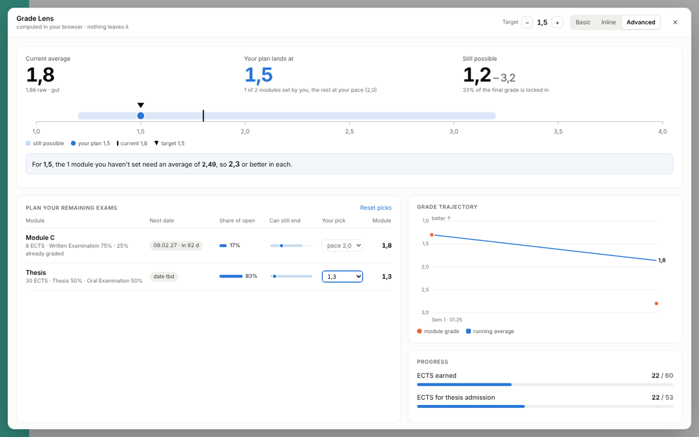
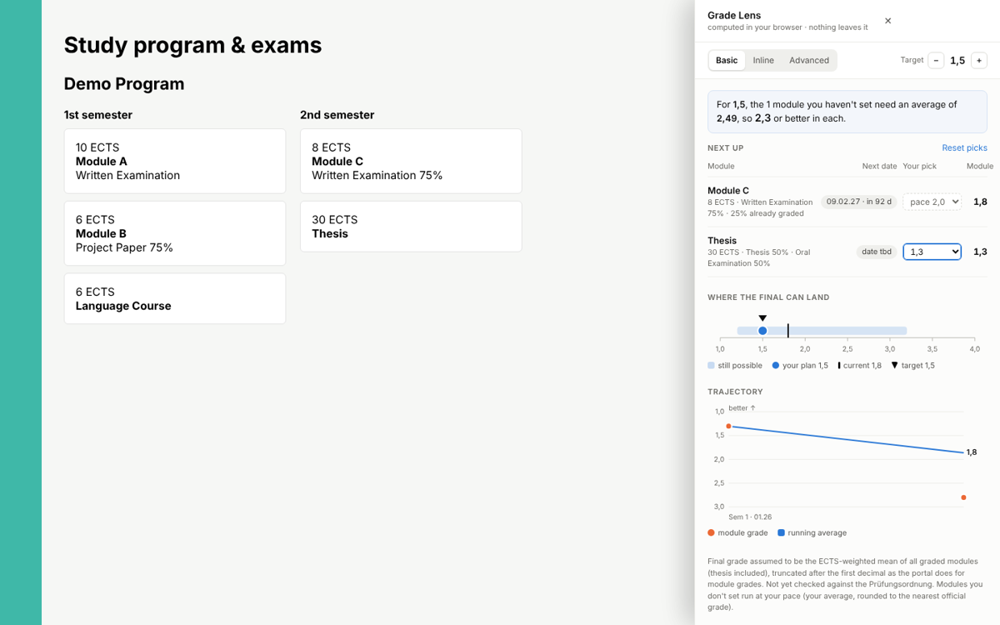
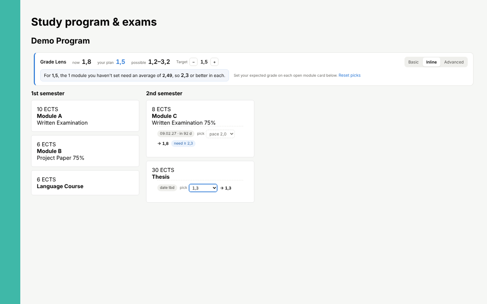
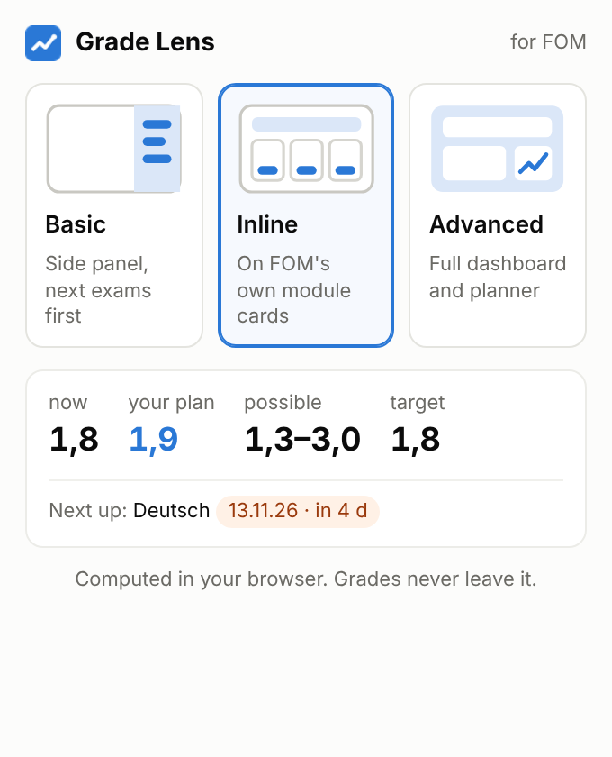

# GradeLens

A Chrome extension for students at FOM University of Applied Sciences. It shows your grade trajectory, the range your final grade can still land in, and what you need in each open exam to hit a target.

It runs entirely in your browser. There is no server, no account, and no data sent anywhere.



*Screenshots use synthetic test data.*

## Features

- **Three views**, chosen from the toolbar popup:
  - **Basic**: a side panel with your next exams first
  - **Inline**: a summary bar plus a grade picker on each of FOM's own module cards
  - **Advanced**: a full dashboard with planner, trajectory and progress
- **Per-module what-if:** pick the grade you expect in each open module and see your final grade update live.
- **Target setter:** choose a target final grade and see what the modules you haven't planned yet need.
- **Final grade range:** best and worst case, and how much of your grade is already locked in.
- **Exam countdown:** your next exam dates, with exams in the next 14 days highlighted.

| Basic | Inline | Popup |
|---|---|---|
|  |  |  |

## How it works

The FOM Online Campus already loads your study book from an internal JSON endpoint (`/campus/api/epm/studybook/{id}`). GradeLens copies that response as the page receives it. It never reads tokens or cookies and makes no requests of its own. All calculations happen locally.

```
src/hook.js      copies the study book response the portal already loads
src/model.js     parsing, validation, averages, final range, what-if (pure functions)
src/panel.js     the three views (Shadow DOM, SVG charts, no dependencies)
popup/           toolbar popup to switch views
```

## Install

1. Download or clone this repo.
2. Open `chrome://extensions` and turn on **Developer mode**.
3. Click **Load unpacked** and select the repo folder.
4. Open the FOM Online Campus → **Study program & exams → Study progress**.
5. Click the GradeLens icon in the toolbar and pick a view.

## Assumptions

- Grades are truncated after the first decimal, as the portal does for module grades.
- The final grade is taken as the ECTS-weighted mean of all graded modules. This is not yet verified against the Prüfungsordnung.
- Only passed modules with a grade from 1,0 to 4,0 count. A failed attempt makes the module an open retake.

## Security

All data from the portal is treated as untrusted. It is validated in one place and escaped when rendered. Messages from the page are only accepted for the study book URL. Permissions are limited to `storage` (your view and picks) and `activeTab` (for the popup).

## Tests

```
npm test            # unit and stress tests
npm run test:e2e    # browser tests (Playwright; set CHROME_PATH to use a local Chrome)
```

## Disclaimer

Independent student project, not affiliated with FOM. It depends on an internal portal API that may change at any time.

Built with the help of an AI model.
